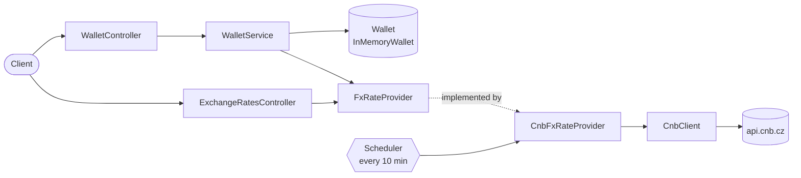

# Design

The blueprint of the multicurrency wallet: what it does, how it is structured, and the decisions behind
it. The code follows this document; when a decision changes, this document changes with it.

## Goal

A REST API for one wallet holding money in many currencies. Money can be deposited and withdrawn in any
currency the Czech National Bank (CNB) quotes, and the total can be shown in any of them, converted with
the latest official CNB fixing. Balances live in memory.

## Structure

Package by feature, with shared code in `common` and Spring wiring in `config`:

```
com.example.wallet
├── domain/wallet    WalletController, WalletService, WalletMapper, WalletTotal, Wallet, InMemoryWallet, dto/
├── domain/fxrate    ExchangeRatesController, ExchangeRatesMapper, FxRate, FxRateTable, FxRateProvider, dto/
├── common/money     Funds
├── common/exception business exceptions, ApiExceptionHandler
├── common/cnb       CnbClient, CnbMapper, CnbFxRateProvider, CnbHealthIndicator, DTOs
└── config           Spring configuration and validated @ConfigurationProperties
```

- **Controllers** only validate the request shape and delegate. **Mappers** are the only place where
  DTOs and domain objects meet. **Services** hold the use cases.
- **Two seams**, both interfaces at a real boundary: `Wallet` (storage) and `FxRateProvider` (the rate
  source). Everything else is a concrete class.
- The domain knows no rate source and no HTTP; CNB is one implementation in `common/cnb`.



## Domain model

| Type | Meaning |
|---|---|
| `Funds(currency, amount)` | An exact amount, always at the currency's ISO 4217 minor units (2 for USD, 0 for JPY); `7` and `7.00` USD are equal |
| `FxRate(currency, units, rate)` | `units` of a currency are worth `rate` in the base currency, as quoted (100 JPY = 13.755 CZK) |
| `FxRateTable(base, validFor, rates)` | One day's fixing against one base currency; converts between any two of its currencies |
| `WalletTotal(total, ratesValidFor)` | All balances converted to one currency, and the date of the fixing used |

### Money rules

- Amounts are `BigDecimal`, never `double`, and strings in JSON (`"10.50"`).
- An amount may not have more decimal places than its currency's minor units (`1.5 JPY` is invalid).
- Pseudo-currencies without minor units (XDR, which CNB quotes) are not money a wallet can hold.
- Conversions keep full precision (`MathContext.DECIMAL128`) and divide once at the end:
  `amount × rateFrom × unitsTo / (rateTo × unitsFrom)`. No "rate per one unit" is ever stored.
- **The total converts every balance exactly, sums, and rounds once**, never per balance: it is a
  valuation at a reference rate, not a series of trades.
- **Rounding is down** (`Funds.ROUNDING_MODE`), so a value is never shown higher than the wallet holds.

## Wallet storage and concurrency

`Wallet` is the storage boundary: atomic commands (`deposit`, `withdraw`, `balances`), deliberately not
load/save, so no implementation can reintroduce a read-then-write race.

`InMemoryWallet` keeps one `ConcurrentHashMap<Currency, BigDecimal>`:

- **Deposit** is `merge(currency, amount, BigDecimal::add)`: concurrent deposits are never lost.
- **Withdrawal** is one `compute(currency, …)` call that checks the balance and subtracts. If the funds
  are insufficient, the function throws and the map leaves the balance unchanged. Concurrent
  withdrawals therefore can never overdraw, without any explicit lock.
- **Balances** returns `Map.copyOf(…)`: a snapshot, consistent per currency, which is all a total needs
  because no operation touches two currencies.
- A fully withdrawn currency stays listed with zero.

With a database, a withdrawal becomes one conditional statement:
`UPDATE balance SET amount = amount - ? WHERE currency = ? AND amount >= ?`.

## API

| Method | Path | Request | Response |
|---|---|---|---|
| `POST` | `/wallet/deposits` | `{currency, amount}` | all balances |
| `POST` | `/wallet/withdrawals` | `{currency, amount}` | all balances |
| `GET` | `/wallet` | – | all balances, sorted by currency code |
| `GET` | `/wallet/total?currency=EUR` | – | `{currency, amount, ratesValidFor}` |
| `GET` | `/exchange-rates` | – | `{ratesValidFor, baseCurrency, rates: [{currency, units, rate}]}` |

- Resources are nouns; deposits and withdrawals are collections under the single wallet.
- Deposits and withdrawals return `200` with the balances: nothing is stored that could be fetched later,
  so there is no `201` with a `Location`.
- Money in JSON is always `{currency, amount}`; the total and the exchange rates say which fixing
  they are based on (`ratesValidFor`).
- Requests are validated with Bean Validation: `currency` and `amount` are required, the amount is
  positive and has at most 15 integer and 15 decimal digits, so absurd input is rejected cheaply.
- Unknown JSON fields are ignored (a tolerant reader); a typo such as `ammount` still fails because the
  real `amount` is then missing.
- springdoc generates the OpenAPI description from the code; a copy is committed as `docs/openapi.yaml`.

## Which operations need exchange rates

| Operation | Needs rates? | Why |
|---|---|---|
| Deposit | yes | we only accept money we can value: its currency must be in the current table (the base always is) |
| Withdrawal | no | any currency held can always be taken out, even while CNB is down |
| Balances | no | no conversion |
| Total | yes | conversion; a zero balance needs no rate, e.g. a currency CNB stopped quoting |

## Errors

Every error is an RFC 9457 Problem Detail (`application/problem+json`), the format Spring Boot uses for
its own errors. Each status means one thing, so a client branches on the status and shows `detail`.

| Status | When | Raised by |
|---|---|---|
| 400 | Invalid request: missing or invalid field (listed in `errors`), a code that is no ISO 4217 currency, too many decimal places, malformed JSON, missing or invalid `?currency=` | Bean Validation, Jackson, `InvalidAmountException`, Spring |
| 404 / 405 / 406 / 415 | Unknown path, wrong method, wrong media type | Spring |
| 409 | Withdrawal larger than the balance of that currency | `InsufficientFundsException` |
| 422 | A real currency we can't value: not quoted by CNB, or a pseudo-currency | `UnsupportedCurrencyException` |
| 503 | A conversion is needed but no rates have been loaded yet | `RatesUnavailableException` |
| 500 | Anything else: logged, the body says only "Unexpected error" | catch-all |

`ApiExceptionHandler` extends Spring's `ResponseEntityExceptionHandler`, so Spring MVC's own errors keep
their default Problem Details. On top of that it has one short handler per business exception, a
catch-all for 500, and two additions to Spring's 400s: the list of invalid fields for `@Valid`, and the
field name when Jackson can't read a value (e.g. currency `"XYZ"`). Domain exceptions don't depend on
Spring.

## CNB integration

CNB declares one fixing per working day at about 14:30 Prague time, valid until the next one (also over
weekends and holidays). For a day without its own fixing, its API answers with the latest earlier one.

- **`CnbClient`** calls `GET https://api.cnb.cz/cnbapi/exrates/daily?date=YYYY-MM-DD&lang=EN` through a
  dedicated `RestClient`: JDK HTTP client, connect timeout 2 s, read timeout 3 s, redirects not
  followed, failed calls retried. CNB normally answers in about 50 ms; without timeouts, a hung connection would block the
  refresh forever.
- **`CnbMapper`** turns the response into an `FxRateTable` with base CZK, the only place that knows the
  base. CNB is a trusted source, so its data is mapped as is.
- **`CnbFxRateProvider`** keeps the latest table in memory and refreshes it on a schedule; requests only
  read it and never wait for CNB.

### Scheduled refresh

A `@Scheduled` task runs every `wallet.cnb.refresh-interval` (10 minutes) on the single scheduler
thread, but calls CNB only when a newer fixing can exist:

1. at startup (nothing cached yet),
2. after a failed refresh,
3. on weekdays after 14:30 Prague time, until today's fixing has arrived.

So there are no calls at night, in the morning or on weekends: about one to three per working day. On a
public holiday CNB keeps returning the previous fixing, which costs one cheap call per interval that
afternoon; a holiday calendar isn't worth a dependency.

- A failed CNB call is retried within the same refresh, four times after 2, 4, 8 and 16 s
  (Spring's `@Retryable`), so a short outage at startup costs seconds, not a whole interval.
- A refresh that still fails keeps the previous fixing and logs one warning.
- Without any rates, rate-dependent requests return 503.
- The state is two `volatile` fields written only by the scheduler thread, so no locks are needed.
- "Today" is the Prague date from an injected `Clock`, so tests can control time.
- `/actuator/health` shows the cache as the `cnb` component: `UP` with the fixing date, or `UNKNOWN`
  while nothing is loaded or after a failed refresh. Never `DOWN`, because withdrawals and balances
  work without CNB.

## Quality

- `./mvnw verify` fails on compiler warnings, Error Prone bug patterns, NullAway null-safety errors
  (packages are JSpecify `@NullMarked`), code not formatted with google-java-format, and test coverage
  below 90 % of lines or 85 % of branches.
- Tests per layer: plain unit tests for the domain, MockMvc tests for the API and its errors, WireMock
  with recorded CNB responses for the client, and end-to-end tests of the whole app with a fake CNB and
  a pinned clock.
- Naming: `getX` returns a value or throws, `findX` returns `Optional`; computations are `calculateX`,
  guards `validateX`, mappers `toTargetType`.

## Out of scope

In-memory storage only (one instance, lost on restart), one anonymous wallet without authentication, no
transaction history, and no idempotency keys, so a retried deposit is applied twice. The README lists
these as known limitations, with what a production version would add.
